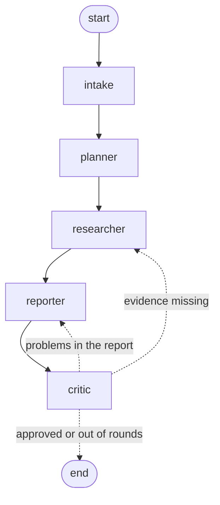

# fraud-investigation-agents

[](https://github.com/DiegoTDDD/fraud-investigation-agents/actions/workflows/tests.yml)
[](https://github.com/DiegoTDDD/fraud-investigation-agents/actions/workflows/eval.yml)

A LangGraph team that investigates card-fraud alerts: a **Planner** chooses what to check, a
**Researcher** runs the checks through two MCP servers, a **Reporter** writes a verdict that
cites the evidence, and a **Critic** checks it and sends work back when the evidence does not
support it. Measured on 30 alerts with known answers against the fraud model alone, plain
rules and a single LLM call. Everything runs free: a local 3B model through Ollama on a CPU.

## Problem

A fraud model can flag a transaction, but an analyst still has to find out *what* happened
(card testing? an unusual amount? a purchase far from home?) and write it up with evidence.
Agents that do this are easy to demo and hard to trust: they can name a pattern the data does not
show, and nobody checks.

## Solution

The compiled graph (generated from the code into [`docs/graph.mmd`](docs/graph.mmd), and a test
keeps it in sync):



| Node | Kind | Does |
| --- | --- | --- |
| intake | code | fetches the alert (evidence E1) |
| planner | LLM | picks hypotheses and lookups (`Plan`, JSON schema) |
| researcher | code + MCP | runs the lookups and states each result as numbered evidence |
| reporter | LLM | verdict, pattern, confidence and cited evidence ids (`Report`, JSON schema) |
| critic | rules | checks the report against the evidence; sends it back with reasons or for more evidence |

Tools, all through MCP:

- **`card-activity`** (this repo): `get_alert`, `get_card_profile`, `get_recent_activity`,
  `get_last_location`. Each one only sees transactions before the alert.
- **`fraud-scoring`** (from [sec-mcp-agent](https://github.com/DiegoTDDD/sec-mcp-agent),
  installed as a pinned dependency): the XGBoost model from
  [realtime-fraud-detection-ml](https://github.com/DiegoTDDD/realtime-fraud-detection-ml) with
  per-feature reasons.

The 30 cases come from the fraud model's test period: 8 high amount, 8 card testing (2 of them
the first charge of a burst, before any pattern exists), 7 impossible travel, 7 legitimate (3
of them outside the home city).

## Results

<!-- EVAL:START -->
The first evaluation run is in progress on GitHub Actions; this section is filled from
`eval/results.md` when it finishes.

Baselines measured before any language model ran: the fraud model alone gets 29 of 30
verdicts right, and the Critic's rules alone name the right pattern in 24 of 30.
<!-- EVAL:END -->

## Run it

```bash
python -m venv .venv && . .venv/bin/activate
pip install -r requirements.txt -r requirements-dev.txt
bash scripts/build_data.sh          # transactions + fraud model at a pinned commit; checks the cases
ollama pull qwen2.5:3b
python scripts/run_eval.py          # eval/results.md and one transcript per case
```

## Tests

`pytest -q -p anyio`: 31 tests. Card facts never look past the alert; every Critic rule
rejects with a specific reason; the graph runs end to end against both MCP servers with a
scripted model through approval, rejection back to the Reporter, missing evidence back to the
Researcher, the round cap, and invalid JSON; the diagram in `docs/graph.mmd` matches the code.

## Design decisions

- [ADR 0001](docs/adr/0001-models-decide-code-fetches.md): language models decide; code fetches and states the numbers.
- [ADR 0002](docs/adr/0002-rule-based-critic.md): the Critic is rules over the evidence, not another model.
- [ADR 0003](docs/adr/0003-reuse-and-pin.md): reuse the other projects, pinned, and rebuild the data in CI.
- [ADR 0004](docs/adr/0004-measure-against-baselines.md): measure the agents against the model and plain rules.
- [ADR 0005](docs/adr/0005-what-the-data-can-and-cannot-show.md): limits of the synthetic data.

## Limits

- The data is synthetic and dense by design (200 cards at the live stream's 10 purchases per
  second, so 4.2 hours), so purchase counts and travel speed carry little information; the Critic
  does not use them (ADR 0005).
- Part of "impossible travel" cannot be told apart from legitimate travel with this data.
- The Critic checks that claims match the evidence, not that the investigation was complete.

## Stack

Python 3.11, LangGraph, MCP Python SDK 2.x, Pydantic, Ollama (qwen2.5:3b), XGBoost, pandas,
pytest, ruff, GitHub Actions.

## License

MIT
